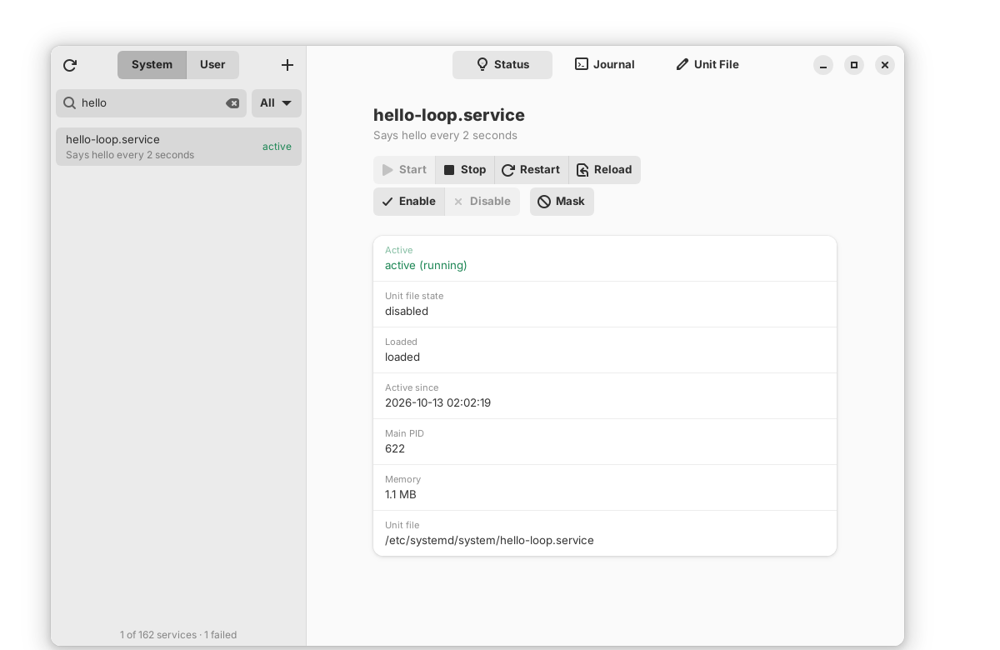

# Systemd Manager

A GTK4 / libadwaita desktop app, written in Rust, for managing systemd services.



## Features

- Lists every service: the ones systemd has loaded plus installed unit files that aren't loaded yet. You can search and filter the list (All, Running, Failed, Inactive, Enabled).
- Updates by itself when services change outside the app (systemctl, crashes, package updates), using systemd's change signals. If the bus connection drops (for example when D-Bus or the user manager restarts), the app reconnects by itself and catches up.
- Switches between **System** services and your own **User** services.
- **Start, Stop, Restart, Reload, Enable, Disable, Mask, Unmask, Reset Failed**. On system services, the polkit password prompt appears when systemd needs it. Masking a system service, or stopping, restarting or disabling one the system depends on (SSH, networking, the display manager, D-Bus and the like), asks you to confirm first.
- **Status** shows active/sub state, why the service last stopped or failed (its result and the main process's exit code or signal), unit file state, active since, main PID, memory, CPU time, tasks, automatic restarts, and the unit file path. **Reset Failed** clears a failed state and the restart counter.
- **Journal** streams the unit's log live, starting from the last 100 to 10,000 lines. **Pause** freezes the view and keeps new lines until you **Resume**. **Find in log** highlights every match; Enter and Shift+Enter (or the arrows) jump between them. **Filters** narrows the log by priority (warnings and errors, or errors only), to the current boot, or to a recent time range, and the save button writes the log to a file.
- **Unit File** lets you view and edit the unit with syntax highlighting and line numbers, then **Save and Reload**, which writes the file and runs daemon-reload. Vendor units (e.g. under `/usr/lib/systemd`) are never modified in place. For those, the editor holds a drop-in override (`/etc/systemd/system/<unit>.d/override.conf`, or under `~/.config/systemd/user/`), the way `systemctl edit` does, so package updates to the unit still apply. **Show Original** shows the packaged file, and **Revert to Vendor** deletes your overrides. If you switch to another service or close the window with unsaved edits, the app asks before discarding them.
- **New service** (the + button) creates a `.service` unit from a form (command, stop command, environment variables, type, restart policy and delay, working directory, user, WantedBy). It checks that the command exists and is executable, and turns a bare command name like `python3` into its full path. It can also enable and start the service right away. Turn on **Run on a schedule** to also create a matching `.timer` with an `OnCalendar=` schedule (checked with `systemd-analyze calendar`), for jobs that should run daily, hourly and so on.
- **Timers** (the alarm button) lists the timers with the unit each one starts and its next and last run. Click one to jump to its service. A service's Status tab shows which timer starts it.
- **Delete** removes a service you created (one whose unit file is in `/etc/systemd/system/` or `~/.config/systemd/user/`): it stops and disables it, deletes the unit file and its drop-ins, and reloads systemd. Vendor units can't be deleted.

### Keyboard shortcuts

| Keys | Action |
| --- | --- |
| Ctrl+F | Search services (or the log, on the Journal tab) |
| Ctrl+N | New service |
| Ctrl+T | Timers |
| F5 | Refresh |
| Ctrl+1 / Ctrl+2 | System / User services |
| Ctrl+Shift+S, Ctrl+Shift+X, Ctrl+R | Start, Stop, Restart the selected service |
| Ctrl+S | Save the unit file and reload |
| Ctrl+P | Pause or resume the journal |
| Alt+1 / Alt+2 / Alt+3 | Status / Journal / Unit File tab |
| Ctrl+? | Show all shortcuts |

## Requirements

- GTK 4.14 or newer, libadwaita 1.5 or newer and GtkSourceView 5 (Ubuntu 24.04+, Debian 13, Fedora 40+, Arch, openSUSE Tumbleweed)
- Rust 1.92 or newer. Distro packages are often older, so install it with [rustup](https://rustup.rs) or run `rustup update`.
- systemd, plus a polkit agent for system-service changes. GNOME, KDE and most desktops already run one.

### Build dependencies

```sh
# Ubuntu / Debian
sudo apt install build-essential pkg-config libgtk-4-dev libadwaita-1-dev libgtksourceview-5-dev

# Fedora
sudo dnf install gcc pkgconf-pkg-config gtk4-devel libadwaita-devel gtksourceview5-devel

# Arch
sudo pacman -S base-devel gtk4 libadwaita gtksourceview5
```

## Install

```sh
./install.sh            # for all users, into /usr/local (asks for sudo)
./install.sh --user     # just for you, into ~/.local (no sudo)
```

To remove it, run `bash uninstall.sh`. It finds every installed copy (in `~/.local`, `/usr/local` or `/usr`), lists what it will delete and asks first. Add `-y` to skip the question, or `--purge` to also delete the `target/` build output. Services you created with the app are left alone.

The script installs missing build dependencies with your package manager (apt, dnf, pacman or zypper), updates Rust through rustup if it is too old, builds a release binary, and installs it with a desktop entry and icon, so Systemd Manager shows up in your app menu. If the file isn't executable after unpacking, run it as `bash install.sh`.

## Build and run without installing

```sh
cargo run --release
```

The binary ends up at `target/release/systemd-manager`. Run it as your normal user, not with sudo. Privileged actions ask for your password through polkit.

Run the tests with `cargo test`.

## How it works

| Piece | File | Notes |
| --- | --- | --- |
| systemd API | `src/systemd.rs` | Talks to `org.freedesktop.systemd1` over D-Bus with `zbus`, and listens for its change signals. Privileged calls set the *allow interactive authorization* flag so polkit can prompt. |
| Journal | `src/journal.rs` | Runs `journalctl -f -u <unit>` (with `--user` for user services) and streams its output into the view. |
| Main window | `src/window.rs` | Holds the list, the status, journal and unit file tabs, and the action buttons. The list is a `GtkListView` that creates rows only for what is on screen and updates changed services in place. D-Bus calls run on worker threads, so the UI never blocks. |
| New service dialog | `src/new_service.rs` | Renders the form into a unit file (and a timer, when scheduled), writes it, runs daemon-reload, then optionally enables and starts it. |
| Timers dialog | `src/timers.rs` | Lists timers with their next and last run. |

Writing system unit files goes through `pkexec` (one call that creates the directory and writes the file) so polkit authorizes the write. User units are written directly to `~/.config/systemd/user/`.

## Notes

- To read logs of system services without root, your user must be in the `systemd-journal` (or `adm`/`wheel`, depending on distro) group. Otherwise journalctl shows only your own messages.
- Enabling/disabling and saving a unit runs daemon-reload afterwards. If your polkit rules don't cache authorization, you may be asked for your password twice.
