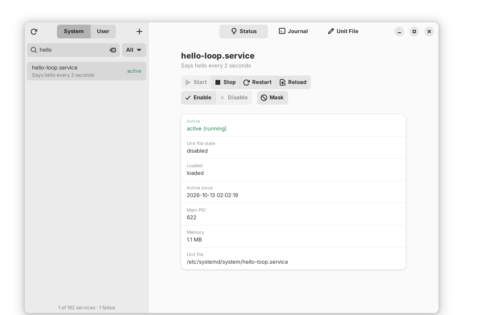

# Systemd Manager

A GTK4 / libadwaita desktop app, written in Rust, for managing systemd services.



## Features

- Lists every service: the ones systemd has loaded plus installed unit files that aren't loaded yet. You can search and filter the list (All, Running, Failed, Inactive, Enabled).
- Updates by itself when services change outside the app (systemctl, crashes, package updates), using systemd's change signals.
- Switches between **System** services and your own **User** services.
- **Start, Stop, Restart, Reload, Enable, Disable, Mask, Unmask**. On system services, the polkit password prompt appears when systemd needs it.
- **Status** shows active/sub state, unit file state, main PID, memory, active since, and the unit file path.
- **Journal** shows the last 100 to 10,000 lines for the unit, and can **Follow** new lines live.
- **Unit File** lets you view and edit the unit, then **Save and Reload**, which writes the file and runs daemon-reload. Vendor units (e.g. under `/usr/lib/systemd`) are never modified in place. Saving one writes an override copy to `/etc/systemd/system/` (or `~/.config/systemd/user/`).
- **New service** (the + button) creates a `.service` unit from a form (command, type, restart policy, working directory, user, WantedBy). It can also enable and start the service right away.

## Requirements

- GTK 4.14 or newer and libadwaita 1.5 or newer (Ubuntu 24.04+, Debian 13, Fedora 40+, Arch, openSUSE Tumbleweed)
- Rust 1.92 or newer. Distro packages are often older, so install it with [rustup](https://rustup.rs) or run `rustup update`.
- systemd, plus a polkit agent for system-service changes. GNOME, KDE and most desktops already run one.

### Build dependencies

```sh
# Ubuntu / Debian
sudo apt install build-essential pkg-config libgtk-4-dev libadwaita-1-dev

# Fedora
sudo dnf install gcc pkgconf-pkg-config gtk4-devel libadwaita-devel

# Arch
sudo pacman -S base-devel gtk4 libadwaita
```

## Install

```sh
./install.sh            # for all users, into /usr/local (asks for sudo)
./install.sh --user     # just for you, into ~/.local (no sudo)
./install.sh --uninstall          # remove (add --user if you installed with --user)
```

The script installs missing build dependencies with your package manager (apt, dnf, pacman or zypper), updates Rust through rustup if it is too old, builds a release binary, and installs it with a desktop entry and icon, so Systemd Manager shows up in your app menu. If the file isn't executable after unpacking, run it as `bash install.sh`.

## Build and run without installing

```sh
cargo run --release
```

The binary ends up at `target/release/systemd-manager`. Run it as your normal user, not with sudo. Privileged actions ask for your password through polkit.

Run the tests with `cargo test`.

## How it works

| Piece | File | Notes |
| --- | --- | --- |
| systemd API | `src/systemd.rs` | Talks to `org.freedesktop.systemd1` over D-Bus with `zbus`, and listens for its change signals. Privileged calls set the *allow interactive authorization* flag so polkit can prompt. |
| Journal | `src/journal.rs` | Runs `journalctl -u <unit>` (with `--user` for user services, and `-f` when following) and streams its output into the view. |
| Main window | `src/window.rs` | Holds the list, the status, journal and unit file tabs, and the action buttons. D-Bus calls run on worker threads, so the UI never blocks. |
| New service dialog | `src/new_service.rs` | Renders the form into a unit file, writes it, runs daemon-reload, then optionally enables and starts it. |

Writing system unit files goes through `pkexec tee <path>` so polkit authorizes the write. User units are written directly to `~/.config/systemd/user/`.

## Notes

- To read logs of system services without root, your user must be in the `systemd-journal` (or `adm`/`wheel`, depending on distro) group. Otherwise journalctl shows only your own messages.
- Enabling/disabling and saving a unit runs daemon-reload afterwards. If your polkit rules don't cache authorization, you may be asked for your password twice.
